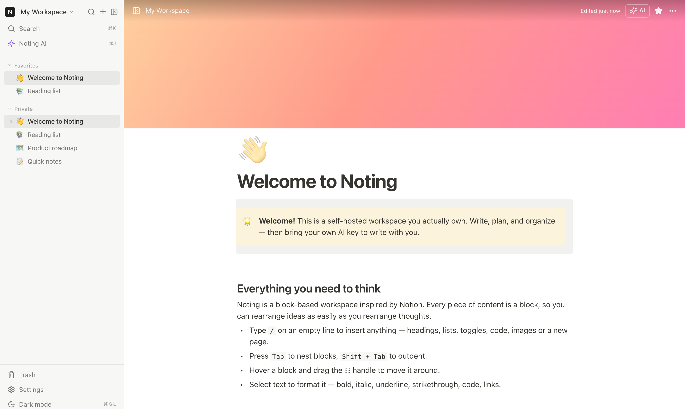

# Noting

A private, self-hosted workspace with a block editor, nested pages, databases, and
bring-your-own-key AI. Built to feel like Notion while keeping every note in a SQLite
file that you own.



## Features

- **Block editor** — headings, lists, to-dos, toggles, quotes, callouts, code blocks,
  dividers, images, and nested sub-pages. Markdown shortcuts (`## `, `- `, `[] `, `> `,
  ` ``` `), a slash menu, drag-to-reorder, and keyboard formatting.
- **Nested pages** — unlimited page trees, favorites, emoji icons, covers, and
  per-page typography.
- **Databases** — table and board views, custom properties (text, number, select,
  multi-select, checkbox, URL, date), sorting, inline editing, and a row detail view.
- **Search** — full-text search across titles and content with a keyboard-first
  command palette, plus recent pages and quick actions.
- **Trash** — restore pages or delete them forever.
- **Dark mode** — light, dark, or follow the system.
- **Bring your own AI** — OpenAI, Anthropic, DeepSeek, Ollama, or any
  OpenAI-compatible endpoint. Your key stays in your browser and is sent only through
  your own Noting server to the provider you choose.
- **Self-hosted** — one Node process and one SQLite file. Optional password protection,
  Docker image, and no telemetry.

## Quick start

Requirements: Node.js 22+ and npm.

```bash
npm install
npm run dev
```

- App: http://localhost:5173
- API: http://localhost:4000

The database is created automatically at `data/noting.db` the first time the server
starts, along with a small demo workspace.

### Production

```bash
npm run build
npm start
```

Open http://localhost:4000. To protect the workspace when hosting it publicly, set a
password:

```bash
NOTING_PASSWORD='something-long' npm start
```

The browser will ask for any username and that password (HTTP Basic auth). Use HTTPS
in front of it — for example with Caddy, nginx, or a Tailscale funnel.

### Docker

```bash
docker compose up -d --build
```

Or without Compose:

```bash
docker build -t noting .
docker run -d --name noting -p 4000:4000 -v noting-data:/data noting
```

The container stores its data in the `/data` volume.

### Desktop app (Electron)

The desktop build reuses the same server and web client, wraps them in Electron, and
stores notes under the OS app-data directory instead of `./data`. It only listens on
`127.0.0.1`.

```bash
npm install
npm run desktop      # build the UI and launch the app
npm run dist:mac     # or dist:win / dist:linux, output in release/
```

CI builds installers for macOS (arm64 + x64), Windows, and Linux via
`.github/workflows/desktop.yml`. Push a `v*` tag to build all platforms and open a
draft GitHub release, or run the workflow manually to download artifacts. Builds are
unsigned unless the `CSC_LINK`, `CSC_KEY_PASSWORD`, `APPLE_ID`,
`APPLE_APP_SPECIFIC_PASSWORD`, and `APPLE_TEAM_ID` secrets are configured.

## Configuration

| Variable          | Default  | Description                                              |
| ----------------- | -------- | -------------------------------------------------------- |
| `PORT`            | `4000`   | Port for the API and the built frontend.                 |
| `NOTING_PASSWORD` | _(unset)_| Enables HTTP Basic auth. Leave unset for a private LAN.  |
| `NOTING_DATA_DIR` | `./data` | Directory for `noting.db` and uploaded images.           |

Copy `.env.example` to `.env` and Noting loads it automatically on startup. Real
environment variables take precedence over values in `.env`.

## Connecting AI

1. Open **Settings → AI**.
2. Pick a provider, or choose **Custom** for any OpenAI-compatible API.
3. Paste your API key and model, then press **Test connection**.
4. Open the AI panel with `⌘J` / `Ctrl+J`, the ✨ button, or `/ai` inside the editor.

Keys are stored in `localStorage` under `noting.ai`. They are never written to SQLite
and never logged. The browser sends each request to the Noting server, which forwards
it directly to your provider and streams the response back. Ollama can run without a
key when it is available on the same machine as the server.

## Keyboard shortcuts

| Shortcut | Action |
| --- | --- |
| `⌘K` / `Ctrl+K` | Search pages and actions |
| `⌘J` / `Ctrl+J` | Open the AI panel |
| `⌘\` / `Ctrl+\` | Toggle the sidebar |
| `⌘⇧N` | New page |
| `⌘⇧L` | Toggle dark mode |
| `⌘⇧P` | Favorite the current page |
| `⌘⇧E` | Export the current page as Markdown |
| `⌘⇧⌫` | Move the current page to trash |
| `Tab` / `Shift+Tab` | Indent / outdent a block |
| `⌘B` / `⌘I` / `⌘U` | Bold / italic / underline |
| `⌘⇧S` | Strikethrough |
| `⌘⇧M` | Block options menu |
| `⌘D` | Duplicate a block |

## Your data

Everything lives in the `data/` directory next to the app:

```text
data/
├── noting.db        # SQLite database (pages, blocks, databases)
└── uploads/         # images uploaded into pages
```

Back up the folder as a whole — copying `noting.db` while the server is running can
miss recent writes because SQLite uses WAL mode. Stop the server first, or use
`sqlite3 data/noting.db ".backup 'backup.db'"`.

## Development

```bash
npm run dev      # API with watch mode + Vite dev server
npm run build    # type-check, then build the frontend
npm run typecheck
npm run seed     # recreate the demo workspace (destructive)
npm test         # run the server tests
```

The frontend lives in `web/src`; styles are split into modules under
`web/src/styles/`. The API and SQLite schema live in `server/`.

## License

Apache-2.0. See [LICENSE](LICENSE).
